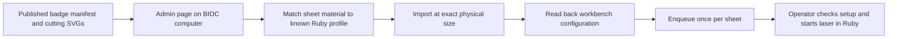

# Ruby production setup

`/admin` is a public, client-only diagnostic page. Open it on the BIDC computer running Ruby. Nothing connects on page load. The operator enters the local API address and a Personal Access Token, then runs the checks and downloads a report. Credentials and responses are held in tab memory; there is no server proxy, upload endpoint, or database write.

The supplied Swagger snapshot identifies the API on `https://localhost:5001`, with its schema at `/swagger/1.0-OpenApi/swagger.json`. The Ruby dashboard uses port 2402; the remote-access certificate is served on port 5000. The snapshot lists operations but contains no request or response schemas, so the diagnostic must retrieve the live schema before we implement mutations.

## What we collect

- OpenAPI schemas, including upload, profile, workbench, queue, and error contracts.
- `GetDeviceStatus`, `GetImportProfiles`, `GetDesigns`, `GetWorkbenches`, `GetQueueElements`, and `GetJobsStatus` JSON responses.
- HTTP status, elapsed time, browser origin/version, and failures. Each request has a 15-second timeout and an 8 MB response bound. Collections are a single API response, not an exhaustive crawl; pagination and required-parameter failures remain visible in the report.
- Optional operator notes identifying known working acrylic and stamp profiles.

The browser requests only these GET endpoints, with cookies omitted and redirects rejected. It never follows URLs from a Ruby response or OpenAPI `servers` entry. Origins are limited to localhost, private IPv4 addresses, and the supplied BIDC hostnames. Network addresses require HTTPS; HTTP is allowed only for loopback diagnostics. Tokens are never placed in URLs or persisted. Submitted tokens, JWTs, and credential fields are redacted from exported responses.

The Windows PowerShell collector provides the same reads plus an OPTIONS request with the production site's Origin and requested Authorization header. It records relevant CORS headers and validates certificates normally. It does not install certificates, change Windows security settings, start a persistent service, or require administrator rights.

A readable 401 proves HTTP access and indicates an authentication problem. A rejected browser fetch cannot distinguish TLS, reachability, local-network permission, CORS, or redirects. Compare the browser and Windows reports; do not label every fetch failure as CORS. A successful read also does not validate laser power, speed, focus, or material suitability.

## Next implementation, after BIDC diagnostics

1. Read the installed API's actual schemas and authentication scheme. Confirm whether the browser can connect directly. If it cannot, use a narrowly scoped local connector; do not open an unauthenticated cloud proxy to Ruby.
2. Map each acrylic type/thickness and stamp rubber to a known working profile. Preserve millimetre dimensions, origin, rotations, red cutting paths, engraving settings, and the stamp's existing manufacturing mirroring. Never infer power/speed settings from the rendered preview. If profiles omit these settings, obtain an operator export before queueing.
3. Import one agreed test sheet, inspect its returned design/workbench, and verify physical dimensions and profile application. This is a later mutation test, not part of diagnostics.
4. Queue each sheet once, using a durable key derived from the published asset hash, sheet identity, profile, and configuration. Record Ruby IDs before retrying. Recover partial imports by reading existing items instead of blindly creating duplicates.
5. Add queue progress using the documented SignalR hub `/publicTrotecNotification` (`DeviceStateInfo`, `QueueInfo`, `JobQueueEntryStateInfo`) after basic import/queue behavior is verified. The current collector does not subscribe or fetch camera streams.

Public access to the diagnostic page does not grant Ruby access. Future job mutations must remain bound to a local operator's authenticated Ruby session/connector and must not be triggered on page load. No physical execution API is included in this design.

References: [Trotec Ruby REST API and profiles](https://www.troteclaser.com/en-gb/helpcenter/software/ruby/ruby-2-9), [Chrome local-network access](https://developer.chrome.com/blog/local-network-access), [browser CORS behavior](https://developer.mozilla.org/en-US/docs/Web/HTTP/Guides/CORS).
