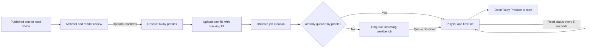

# Badge production

Open `/admin` on the BIDC computer running Ruby and its TrayApp. The dark interface uses Purdue Hackers’ PolySans, PixelHackers, glider, and yellow actions.

## Choose → Review → Produce

1. **Connect.** Enter a Ruby Personal Access Token once. The API defaults to `https://localhost:5001`, targeting `X4-0436`. Connection settings remain editable. A successful device request establishes the connection.
2. **Choose.** Add one or more published Hack Night sets, or upload cutting SVGs. Choose each file’s role and acrylic. Published sheets supply their material and thickness through their filenames. Local files without that metadata default to ⅛-inch acrylic and require a color selection. Stamp cutting files must already be mirrored; their orientation is preserved when sent to Ruby.
3. **Review.** Check the acrylic badge renders, finished stamp impressions, cutting files, and required materials. The local preview reverses a mirrored stamp to show its impression. It does not change the uploaded file. Published sets show each selected acrylic; local files each receive a preview. Unsupported artwork shows a labeled flat fallback.
4. **Confirm.** “Queue jobs” starts the batch. The page resolves both import profiles before uploading anything, then imports each file and observes its job in Ruby’s queue.
5. **Produce.** The playlist shows the batch’s jobs. Selecting a thumbnail changes the laser schematic and file details. The timeline reflects Ruby’s job states and reported progress. Other users’ queue entries are counted but never modified.

The laser view is an interactive schematic, not a camera feed or a live head-position simulation. Progress and remaining time are shown only when the device’s running job matches this batch. Estimated elapsed time is labeled with `~`. Connection failures hide live progress until reads recover. Starting the physical laser still uses **Open in Ruby**, which goes to `/app/produce`; the captured public API does not expose a start command.

The Speedy 400 enclosure follows [Trotec’s 8070 overview](https://www.troteclaser.com/static/pdf/speedy-400/8070-Speedy-400-flexx-Operating-manual-EN.pdf). Its working area is 1016 × 610 mm (40 × 24 inches). SVG width and height in physical units determine the material footprint; artwork without physical dimensions is not fitted to the bed. Badge sheets appear at the back-left. Stamp placement uses the stamp’s top-left corner, measured from the bed’s left and back edges. On the real machine, the operator must choose unused rubber and align the laser pointer in Ruby; the captured API cannot read or set that position.

**Use simulated laser** creates a browser-local device with separate batches and receipts. Each job takes one minute of simulated time. Start, pause, and resume are beside the timeline; there are no speed or fault settings. Before each stamp, the laser preview becomes a placement map. Choose its top-left corner, confirm unused rubber, and press **Start stamp**. The simulator checks bed bounds and overlap with earlier stamp placements. Placement survives reloads. **New batch** clears simulated jobs, used areas, and selected files; real upload history is retained. Simulation never sends requests to the physical laser.

Simulator state and its connection use versioned localStorage keys. A schema change starts a new test device while keeping the selected SVGs. This prevents an older open tab from erasing new fields such as stamp placement. Placement is read directly from the simulator, not from shared upload receipts.

## Browser storage and identity

- `ruby-connection-v1` in localStorage holds the token, API origin, device serial, and optional display name. Reloading reconnects with a read-only device request. **Sign out** removes the saved credentials and stops this page’s connection; it does not cancel jobs already accepted by Ruby. Other open tabs also disconnect when credentials change.
- The account name comes from the token’s name/email claim when present. Otherwise the operator can give this machine a display name. The token’s account ID appears in the account tooltip. Decoded claims are display information; Ruby validates the token.
- IndexedDB `ruby-production` / `batch` retains the selected files, material choices, and batch ID. localStorage `ruby-imports-v1` retains import receipts, tracking IDs, and queue observations. Reloading restores the batch without automatically uploading or enqueueing. **Retry queue** appears when a confirmed batch has unfinished uploads or queue errors; status reads otherwise refresh automatically.
- **New batch** creates a new batch ID, allowing an intentional repeat of the same files. Signing out preserves the files and receipts so a later connection can resume.
- The public page never retrieves `RUBY_API_TOKEN` from Vercel. The browser sends credentials directly to Ruby, not to the badges backend. Credentials must never be included in a public route or `NEXT_PUBLIC_` variable.

## Ruby integration

`/api/admin/releases` reads `purduehackers/badge-designs`, caches the catalog for one minute, and pins its assets to one commit. Cutting sheets and `stamp.svg` are sent to Ruby; `badge.svg` supplies the individual badge render. A catalog failure leaves local uploads available. Locally uploaded sheets exported by this application can also render their original `badge-art` group.

The import profiles are **Purdue Hackers Badges** (Acrylic 1/8) and **Purdue Hackers Stamps** (2.3mm). Their processing settings are owned by Ruby and were accepted by the operator. Profiles must create a job; a profile that only saves a design cannot be promoted to a job by the captured public API. The website does not change processing parameters.

`UploadFromMany` receives one multipart `uploadedFiles` part, `importProfileId`, and a unique `trackingNumber`. SVG bytes, dimensions, and orientation are unchanged. The Ruby filename includes a unique suffix to correlate a workbench when Ruby omits tracking information. Requests use `Authorization: PersonalAccessToken …`, `x-api-version: 1.0-OpenApi`, and `x-target-device`.

An HTTP upload success means **accepted**, not **queued**. The app polls `GetJobsStatus` and `GetQueueElements`. It gives the import profile time to complete its own queue action before checking `GetWorkbenches`. After another queue read, it submits only matching workbench UUIDs as a JSON array to `EnqueueWorkbench`. A queued state requires a subsequent API observation.

Receipts are saved before each upload and enqueue attempt. Filename, SHA-256, batch ID, API origin, and serial identify an import. Web Locks serialize batch sends between tabs. Files already accepted within that batch are not uploaded again. Two identical sheets with distinct filenames remain separate jobs.

Uncertain uploads, queue errors, missing profiles, and errored jobs stop the remaining batch. A lost enqueue response is reconciled through reads, without automatically repeating the POST. Explicit upload validation rejections can be retried. This is browser-local duplicate protection; it cannot guarantee deduplication after cleared storage, across computers, or against changes made directly in Ruby. Ruby’s asynchronous profile actions and explicit enqueue still need an on-site check.

Reads time out after 15 seconds; uploads after 60 seconds. Queue observation waits are bounded and can be resumed. API origins are restricted to localhost, private IPv4, or the BIDC hostnames; network addresses require HTTPS. Requests omit cookies and reject redirects. Diagnostic reports redact tokens and credential fields.

## Verification

The October 22 BIDC reports established direct browser access and PersonalAccessToken authentication. With `x-target-device: X4-0436`, the API identifies a Speedy 400 Flexx, its active job/progress, and queue entries.

The October 29 report supplied the two import profiles and the public API schema. The operator subsequently confirmed that profile-based uploads worked. The schema exposes uploads, workbenches, enqueue, and status; it does not expose start/pause/stop or an account-name endpoint.

Browser checks against a simulated Ruby API cover profile-driven and explicit queuing, delayed job creation, unchanged SVG bytes, confirmation before writes, missing profiles, uncertain uploads, rejected imports, enqueue failures, batch restoration, repeat batches, login storage, render output, and mobile layout. No physical laser was operated during these checks.

On BIDC, confirm one batch produces the expected number of jobs, with the intended profiles, dimensions, orientation, and material settings. Download **Connection help → Collect debug report** if job creation or queue correlation differs from the simulated API.

References: [Ruby REST API and profiles](https://www.troteclaser.com/en-gb/helpcenter/software/ruby/ruby-2-9), [Ruby 2.11 manual](https://www.troteclaser.com/static/pdf/Knowledge/ruby-help/Ruby_V2.11_SM_en-us.pdf).
