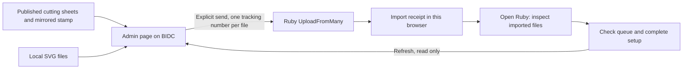

# Ruby production MVP

Open `/admin` on the BIDC computer running Ruby and its TrayApp. Choose published cutting files or local SVGs, connect to Ruby, and send the files using the appropriate Ruby import profile. The operator checks the imported files and queue in Ruby.

The dark-only admin page uses Purdue Hackers’ current [site identity](https://github.com/purduehackers/site2026): PolySans for interface text, PixelHackers for the heading, the glider mark, and yellow actions with purple focus indicators. The bundled fonts and glider come from that repository. These styles are scoped to `/admin`.

The page follows one column: connect, select files, upload, then continue in Ruby. API address and laser serial default to the BIDC setup and remain editable under Connection settings. Upload history, queue, and connection help use native disclosures; failed or uncertain uploads stay visible and open their history automatically.

The page stays public. Ruby credentials remain in tab memory and travel directly to the local Ruby API. No request to the badges server carries the Ruby token. Nothing contacts Ruby or imports files on page load.

`RUBY_API_TOKEN` is stored as a production Secret in Vercel. The public page does not retrieve it: a protected unlock must be chosen before adding saved-token access. Until then, paste the token into the local connection form. Never expose this variable through a public route or a `NEXT_PUBLIC_` variable.

## Flow

- `/api/admin/releases` reads the public `purduehackers/badge-designs` repository, caches the catalog for one minute, and pins downloads to a commit. It lists cutting sheets and `stamp.svg`, excluding source designs and individual badge exports. A catalog failure leaves local uploads available.
- SVG bytes, dimensions, and orientation are preserved. Published stamp files are already mirrored. Displayed dimensions are rounded for readability only; missing physical dimensions are called out for checking in Ruby.
- Before uploading, the page fetches `GetImportProfiles` and resolves every pending file to exactly one named profile: `Purdue Hackers Badges` or `Purdue Hackers Stamps`. Published `stamp.svg` files default to the stamp profile; other files default to badges. Each file has a profile selector for local files or corrections. A missing or ambiguous profile stops the batch before any upload.
- `UploadFromMany` receives one multipart `uploadedFiles` part per request. The request includes the selected `importProfileId`, `trackingNumber`, `PersonalAccessToken`, `x-api-version: 1.0-OpenApi`, and `x-target-device`. Profile IDs are fetched for each send rather than hardcoded. Import receipts record the profile ID and name; older receipts remain readable.
- An HTTP success means Ruby accepted the upload. It does **not** establish that a design is configured, queued, or safe to cut. The page has no enqueue, delete, material-setting, or laser-start action.
- Device and queue refreshes run together. HTTP 204 is shown as unavailable data, not an empty queue. `GetJobsStatus` is called only with a receipt's tracking number.
- Import receipts are written to localStorage **before** each POST. Their identity includes filename, SHA-256, API origin, and laser serial. Two identical physical sheets with distinct filenames are separate jobs. Repeat selections of the same file are skipped. Web Locks serialize imports and receipt updates between tabs of the same site.
- Network failures and server errors leave an uncertain receipt and stop the batch. Reloading retains it. Check the import or inspect Ruby instead of blindly retrying. Explicit validation/authentication rejections can be retried after correction. This is browser-local duplicate protection, not a guarantee across computers, cleared storage, or manually renamed files.
- Browser diagnostics include the API schema, device, profiles, designs, workbenches, and queue. Reports redact submitted tokens, JWTs, and credential fields. Reads have 15-second timeouts; uploads have a 60-second timeout and no automatic retries.

## What is verified

The October 22 BIDC reports establish direct browser access and PersonalAccessToken authentication. With `x-target-device: X4-0436`, the API identifies a Speedy 400 Flexx, its active job/progress, and 13 queue entries. The operator confirmed that the laser was connected and no import profiles existed.

The October 29 BIDC report records `ERR_IMPORTPROFILE_002` (HTTP 400) for profile-free uploads and lists the newly created `Purdue Hackers Badges` (Acrylic 1/8) and `Purdue Hackers Stamps` (2.3mm) profiles. Although the OpenAPI schema marks `importProfileId` optional, this upload flow now supplies it explicitly. The API exposes profile names and material labels, not their processing settings. The operator has accepted these profiles; the website does not modify them.

Local verification covers published-file loading, unchanged multipart uploads, accepted/rejected/uncertain outcomes, tracking recovery, duplicate prevention, and the browser queue UI against a simulated Ruby API. It does not verify the laser, imported geometry, or processing parameters.

## On-site check

1. Open `/admin` on BIDC, enter the token, and connect to `https://localhost:5001` with serial `X4-0436`.
2. Choose the cutting SVGs, check each file’s profile, and send them. Confirm Ruby accepts the uploads with their profile IDs.
3. Open Ruby at port 2402. Inspect the imported dimensions, orientation, artwork, and material settings.
4. Check whether the profiles already queued the jobs before adding any, then Refresh on `/admin`.
5. If import fails or remains uncertain, download the diagnostic report and import receipts. Do not send a second copy until the first attempt is accounted for.

The local origin is restricted to localhost, private IPv4, or the supplied BIDC hostnames. Network addresses require HTTPS. Requests omit cookies, reject redirects, and never follow URLs supplied by Ruby.

References: [Trotec Ruby REST API and profiles](https://www.troteclaser.com/en-gb/helpcenter/software/ruby/ruby-2-9), [Ruby 2.11 manual](https://www.troteclaser.com/static/pdf/Knowledge/ruby-help/Ruby_V2.11_SM_en-us.pdf), [Trotec Smart Add-on](https://www.troteclaser.com/en-us/helpcenter/software/ruby/ruby-workflow-tips/trotec-ruby-smart-add-on).
