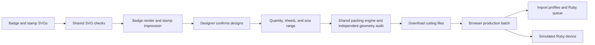

# Badge website

The website and Discord bot share the SVG inspector, manufacturing exports, material definitions, packing search, and layout audit. Neither client maintains a second set of manufacturing rules.

## Design flow

`/` accepts one SVG for each role. Roles are explicit; filenames never assign roles. Choose the Hack Night and acrylic sheets before reviewing the material render. The event catalog and available sheets come from the existing CMS and dedicated badges database. Either source can fail independently; manual event details and sheet sizes remain available.

`POST /api/designs` runs deterministic SVG checks. Failed or unknown checks keep the user on the upload step and explain the required change. Passing checks unlock the designer's visual confirmation: expected version and date, readability, thin connections, and stamp impression. Black in a stamp SVG means rubber removed; the submitted design is unmirrored.

After confirmation, manufacturing chooses a minimum quantity and available sheets. Colors, sheet sizes, and quantities can be mixed. The default size range is 1.8–2.5 inches along the longest side; an explicit larger range supports unusual designs such as swords. The bounded heuristic search attempts a larger size while meeting the minimum, keeps additional copies that fit, and independently audits overlap and the 0.2-inch sheet margin. It does not claim a mathematically optimal nesting.

Generated cutting files preserve the original engraving and red cutting geometry. The stamp export is mirrored and has a 1.5-inch shortest side. Downloads and packing previews do not reserve or deduct inventory, publish to GitHub, or create shortlinks. Discord publication continues to own those existing transactional effects.

## Browser state and production

Design drafts and generated files live in IndexedDB on the current browser. Replacing an SVG clears file checks, designer confirmation, and the layout. The production handoff carries the single-badge preview separately from cutting sheets, so a sheet is never rendered as a giant badge. Ruby credentials remain in the separate existing localStorage connection entry; design API requests never include them.

`/admin` accepts the prepared batch, published releases, or existing cutting files. The saved Ruby connection, upload receipts, cross-tab lock, profile selection, and queue reconciliation remain the production boundary. Production only queues after explicit confirmation. Physical jobs still start from Ruby's Produce screen; the simulated device runs entirely in the browser.

## Interface

All routes share the dark Purdue Hackers theme and copied React components from [ph/components](https://components.purduehackers.com). `src/app/ph.css` is the official theme; `src/components/ph` contains the copied components and their styles. Application CSS supplies layout, not another brand palette. The standalone `/viewer` shares the renderer, and existing `/?badge=` links remain valid.
