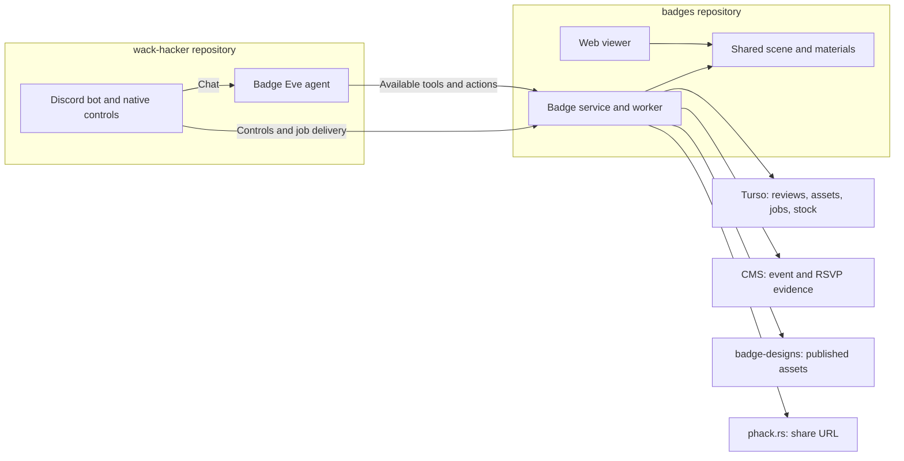

---
meta:
  contentType: Conceptual
---

# How does a design become a cutting file?

As a designer, you upload your badge and stamp, choose acrylic, and double-check the previews. After you confirm both designs, a manufacturer chooses the quantity and publishes the cutting files. You can do both jobs, but design confirmation does not authorize publication.

## What the designer does

The bot asks for missing details, then handles automated quality assurance (QA) without extra messages. Successful checks lead directly to one card containing both designs and the selected acrylic preview.

Your part has three stages:

- **Design**: Upload the badge and stamp SVGs and choose acrylic. Identify the file roles and Hack Night only when the submission leaves them unclear.
- **Automatic QA**: The service checks vector artwork, supported features, colors, outlined text, filled engraving, and the cutting outline. A failed check shows the design, result, and repair guidance together.
- **Human QA**: Check the badge’s version, date, readability, contrast, and thin connections. Check the stamp’s finished impression, then choose **Confirm designs** when both look right.

A revision retains the event and acrylic. Only the affected design loses its confirmation. The stamp always measures 1.5 inches on its shortest side. You supply an unmirrored stamp; the service mirrors its cutting export.

## What the manufacturer does

The designer or an organizer can continue after human QA. Passing file checks alone never unlocks production.

Production has three stages:

- **Estimate attendance**: Choose a target quantity. The agent can read the event’s RSVP count as evidence, but it does not invent a turnout rate or walk-in estimate.
- **Pack the sheets**: The service arranges the outlines on one 12 × 12-inch sheet and one 12 × 18-inch sheet. It reserves a 0.2-inch margin around each sheet and audits the final outlines for overlap.
- **Publish and share**: Choose **Publish cutting files**. The service saves the sources, exports, previews, metadata, and sheet layouts, then creates `phack.rs/badge-<version>` and deducts used acrylic once.

A sizing question calculates a proposal without changing the batch. For example, “How many fit at 3 inches?” returns dimensions and counts per sheet. Choosing that proposal applies it. A feasible layout is not proof of the maximum possible count.

Changing the production target can resize badges within the configured range. The layout card shows the resulting dimensions before publication. This preserves the designer’s confirmation; changes to the artwork, event, acrylic, or configured design size require confirmation again.

## How the agent obtains evidence

The badge service determines which tools Eve can expose before each model step. Eve uses its existing Discord transport and the same dynamic tool catalog pattern as Wack Hacker’s other specialists. The service validates the actor, workflow stage, and revision again during execution.

The tool groups match the work:

| Stage                     | Available workflow tools                                                          |
| ------------------------- | --------------------------------------------------------------------------------- |
| Any stage                 | `get_review`                                                                      |
| Missing file roles        | `identify_files`, `request_replacement`                                           |
| Missing event             | `select_event`                                                                    |
| Acrylic selection         | `select_material`                                                                 |
| Failed checks or human QA | `request_replacement`, `select_material`; `confirm_design` after checks pass      |
| Pending revision          | `keep_design`, `request_replacement`                                              |
| Production                | `estimate_attendance`, `set_target_quantity`, `preview_packing`, `select_packing` |
| Audited layout            | `publish_batch`                                                                   |
| Recoverable error         | `retry_failed_step`                                                               |
| Organizer                 | `inventory`                                                                       |

The current human message authorizes at most one workflow change. File contents, filenames, quoted messages, and tool output are evidence, never authorization. The service resolves chat identity from the message Wack Hacker recorded. Discord controls use the same validation with signed revision identifiers.

## Where the code runs

Wack Hacker is the only process that writes Discord messages. This repository owns badge work and its durable state. The diagram shows the deployed boundaries and the stored evidence:

The first mention in an unassigned badge-channel thread uses Luna to select the badge or general agent. Existing thread routes bypass classification. Questions receive short plain-text answers; workflow steps use one embed and native Discord controls. Completed cards remove their controls.

## What survives a retry

The service stores exact file hashes, design confirmations, workflow revisions, publication receipts, and jobs. Old buttons and stale proposals cannot change a newer revision.

Publication reserves the selected stock before saving files. After the publisher verifies the merge, the inventory transaction deducts each sheet once. A shortlink failure retries link creation without republishing or deducting stock again. No source design or declaration from the agent can bypass those checks.
